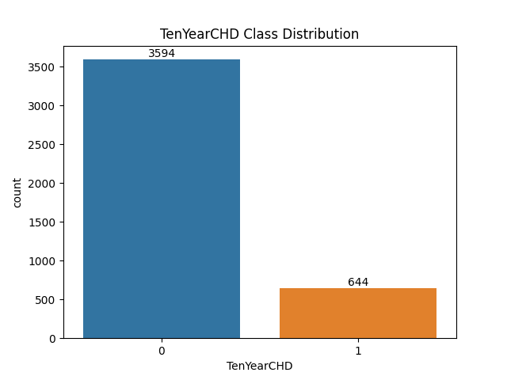
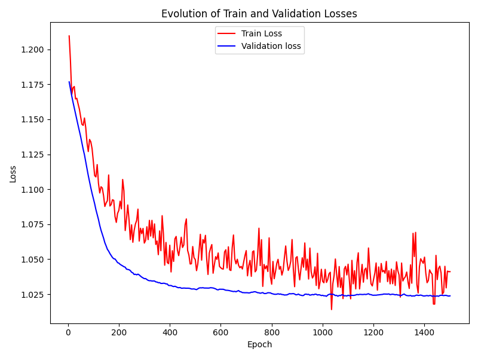
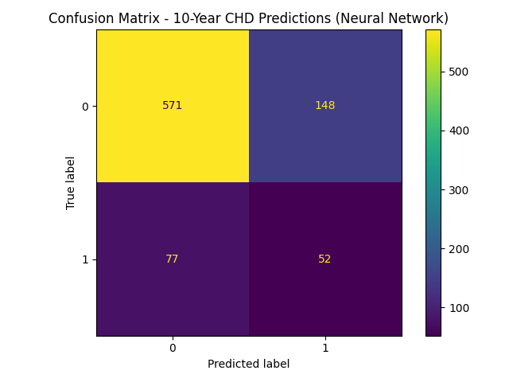
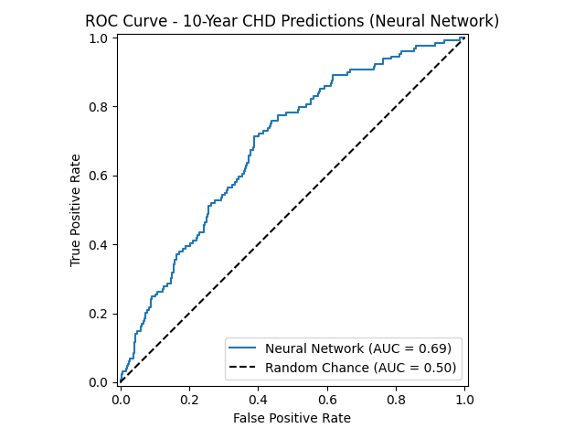

# Tabular Binary Classification with PyTorch: 10-Year Heart Disease Prediction

## Project Introduction

Finding out early if someone might get heart disease can help save lives. When doctors know who is at high risk, they can help those patients make healthy changes before a serious heart problem happens.

In this project, we built a machine learning system using **PyTorch** and **scikit-learn** to predict if a person will develop Coronary Heart Disease (`TenYearCHD`) within the next 10 years. We used real patient health records from the **Framingham Heart Study** (`data/raw-data/framingham.csv`). Instead of putting everything into one messy file, we organized the project into three clear steps: cleaning the data, training the neural network, and testing how well it works on new data.

---

## About the Data & Main Challenges

Working with real hospital and health data comes with two big problems that we had to solve:

1. **Uneven Data (Class Imbalance):** In this dataset, most people do **not** get heart disease (`0`), while only a small number of people **do** get it (`1`). Because the data is heavily uneven, standard metrics like **accuracy** and **precision** alone do not give a fair picture—a model could just guess "no heart disease" for everyone, get a high accuracy score, and still miss the sick patients who actually need help. For that reason, we did **not** rely on accuracy or precision, and instead chose **ROC-AUC**, **Recall**, and **F1-Score** to judge how well our model works.
2. **Missing Information:** Many patient records have blank or missing values for things like blood pressure, cholesterol, or smoking habits. If we fill in those missing numbers before splitting our data, information from the test set can leak into the training set and give us fake, overly high scores.



---

## How the Project Works (Step-by-Step)

To keep our work clean and avoid data leaks, we split the project into three notebooks inside the `notebooks/` folder:

### Step 1: Cleaning and Preparing the Data (`01_data_cleaning_and_preprocessing.ipynb`)
* **Splitting the Data First:** Before doing anything else, we split the raw data (`data/raw-data/framingham.csv`) into three separate parts: a training set (`train_processed.csv`), a validation set (`val_processed.csv`), and a test set (`test_semi_processed.csv`).
* **Filling Blanks and Scaling Numbers:** We filled in missing values separately for number columns (`numerical_imputer.joblib`) and category columns (`categorical_imputer.joblib`). Then, we converted categories into numbers using one-hot encoding (`one_hot_encoder.joblib`) and scaled all number columns so they are on the same range (`standard_scaler.joblib`).
* **Saving the Tools:** We saved all four data-cleaning tools in the `artifacts/` folder. This way, when we test our model later, we clean the test data using the exact same rules learned from the training data.

### Step 2: Training the Model & Finding the Best Threshold (`02_model_training_and_tuning.ipynb`)
* **Training with PyTorch:** We built and trained a neural network in PyTorch using the cleaned training data. We watched the training and validation loss curves (`plots/train_validation_loss_evolution.png`) to make sure the model was actually learning patterns and not just memorizing the training data.
* **Tuning the Decision Cutoff (Threshold):** By default, models predict "yes" if the probability is above `0.50` (50%). Because our data is uneven, `0.50` is not the best choice. We tested many different cutoff values on the validation set to see which one gave the best F1-score.
* **Saving the Model and Cutoff:** The best cutoff turned out to be **`0.60`**, which gave a **validation F1-score of `39.53%`**. We saved the trained model weights (`model/neural_network.pth`) and the best cutoff number (`model/threshold.txt`) as separate files so they are easy to load and use later.



### Step 3: Testing on Unseen Data (`03_model_evaluation_and_metrics.ipynb`)
* **Final Check:** We took the untouched test data (`data/cleaned-data/test_semi_processed.csv`), cleaned it with our saved tools in `artifacts/`, and made predictions using our saved PyTorch model (`model/neural_network.pth`) and our `0.60` cutoff (`model/threshold.txt`).
* **Checking the Results:** We measured how well the model performed using ROC-AUC, Recall, and F1-Score, and saved charts of the results in the `plots/` and `evaluation-metrics/` folders.

---

## Results on the Test Set

When we tested our trained PyTorch model on the unseen test data using the **`0.60`** threshold, here is what we got:

| Metric | Validation Set | Test Set (Unseen Data) | What This Means in Simple Terms |
| :--- | :---: | :---: | :--- |
| **Decision Threshold** | `0.60` | `0.60` | The probability cutoff chosen on the validation set |
| **ROC-AUC Score** | — | **68.83%** | Shows the model can tell high-risk and low-risk patients apart |
| **Recall (Sensitivity)** | — | **40.31%** | The model successfully caught over 40% of real heart disease cases |
| **F1-Score** | **39.53%** | **31.61%** | The overall balance between catching real cases and avoiding false alarms |

### What We Learned from These Results
* **Choosing the Right Metrics Matters:** Because the Framingham dataset is heavily imbalanced, avoiding accuracy and precision in favor of **ROC-AUC**, **Recall**, and **F1-Score** gave us an honest view of how well the model identifies high-risk patients.
* **The Model Actually Learned:** Getting a **68.83% ROC-AUC** score on brand-new test data proves that the PyTorch neural network picked up real health patterns from the patient records instead of just guessing the majority class.
* **Why Tuning the Cutoff Helped:** Using our **`0.60`** threshold allowed the model to catch **40.31%** of patients who truly developed heart disease within 10 years, while keeping a **31.61% F1-score**.
* **Clean and Repeatable Setup:** By saving our data-cleaning tools (`artifacts/`), model weights (`model/neural_network.pth`), and threshold (`model/threshold.txt`) separately, anyone can run this project and get the exact same results shown in `evaluation-metrics/metrics_test_set.png`.

| Test Set Confusion Matrix | Test Set ROC Curve |
| :---: | :---: |
|  |  |

---

## Folder Structure

```text
pytorch-tabular-binary-classifier/
├── artifacts/                                  # Saved data-cleaning tools
│   ├── categorical_imputer.joblib
│   ├── numerical_imputer.joblib
│   ├── one_hot_encoder.joblib
│   └── standard_scaler.joblib
├── data/
│   ├── raw-data/
│   │   └── framingham.csv                      # Original heart study dataset
│   └── cleaned-data/
│       ├── train_processed.csv                 # Cleaned training data
│       ├── val_processed.csv                   # Cleaned validation data
│       └── test_semi_processed.csv             # Test data ready for final cleaning
├── evaluation-metrics/
│   └── metrics_test_set.png                    # Image of final test scores
├── model/
│   ├── neural_network.pth                      # Saved PyTorch model weights
│   └── threshold.txt                           # Best decision cutoff (0.60)
├── notebooks/
│   ├── 01_data_cleaning_and_preprocessing.ipynb
│   ├── 02_model_training_and_tuning.ipynb
│   └── 03_model_evaluation_and_metrics.ipynb
├── plots/
│   ├── target_class_distribution.png           # Chart showing uneven classes
│   ├── train_validation_loss_evolution.png     # Chart of training vs. validation loss
│   ├── confusion_matrix_test.png               # Test set confusion matrix
│   └── roc_curve_test.png                      # Test set ROC curve
├── requirements.txt                            # List of Python libraries needed
└── README.md                                   # Project guide and results
```

---

## How to Download and Run This Project

Follow these simple steps to copy this project to your computer and run it yourself:

1. **Download (Clone) the Repository**
   Open your terminal or command prompt, go to the folder where you keep your coding projects, and download this repository from GitHub:
   ```bash
   git clone [https://github.com/nfor-ojong/pytorch-tabular-binary-classifier.git](https://github.com/nfor-ojong/pytorch-tabular-binary-classifier.git)
   cd pytorch-tabular-binary-classifier
   ```

2. **Create and Turn On a Virtual Environment**
   Creating a virtual environment keeps the Python packages for this project separate from the rest of your computer:
   * **On Mac or Linux:**
     ```bash
     python3 -m venv venv
     source venv/bin/activate
     ```
   * **On Windows (Command Prompt / PowerShell):**
     ```bash
     python -m venv venv
     venv\Scripts\activate
     ```

3. **Install the Required Libraries**
   With your virtual environment turned on, install PyTorch, scikit-learn, pandas, and all other tools listed in `requirements.txt`:
   ```bash
   pip install --upgrade pip
   pip install -r requirements.txt
   ```

4. **Open Jupyter and Run the Notebooks in Order**
   Start Jupyter from the main project folder (`pytorch-tabular-binary-classifier/`) so all file paths work properly:
   ```bash
   jupyter lab
   ```
   Open and run the three notebooks one after the other:
   * **First:** Run `notebooks/01_data_cleaning_and_preprocessing.ipynb` to clean the raw data and save the `.joblib` tools.
   * **Second:** Run `notebooks/02_model_training_and_tuning.ipynb` to train the PyTorch model, find the best cutoff (`0.60`), and save `neural_network.pth` and `threshold.txt`.
   * **Third:** Run `notebooks/03_model_evaluation_and_metrics.ipynb` to test the model on the unseen test data and generate the final charts and scores.

---

## Author & Contact

* **GitHub:** [@nfor-ojong](https://github.com/nfor-ojong)
* **Email:** nforojong2@gmail.com

---

## Conclusion

This project shows how careful data cleaning, a PyTorch neural network, and tuning the decision threshold can work together to predict heart disease risk from uneven patient data. *Note: This is a learning project built with a public dataset and is not intended for medical use.*
